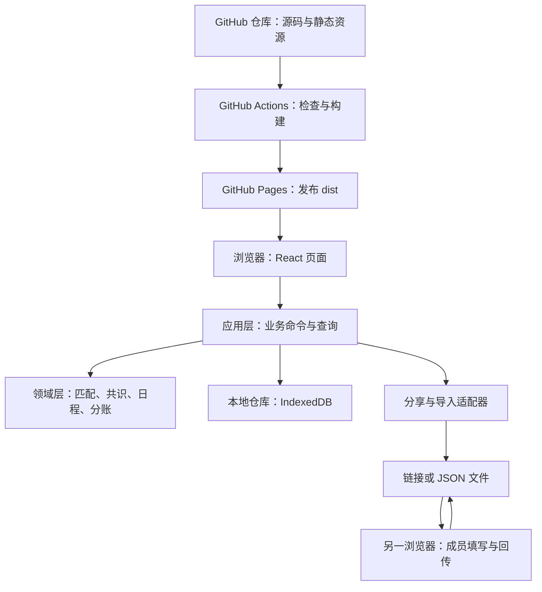
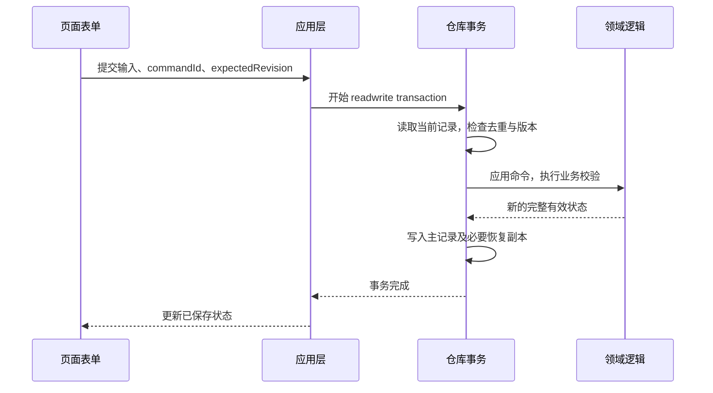

# 同路 · 毕业旅行技术栈与系统架构

版本：MVP v1.0  
日期：2026-11-18  
状态：架构设计，尚未初始化应用或安装依赖  
配套文档：[PRD](./PRD.md)、[业务规则](./BUSINESS_RULES.md)、[页面设计](./pages.md)、[MVP 开发文档](./MVP_DEVELOPMENT.md)

## 1. 目标与架构决策

构建可部署到 GitHub Pages 的浏览器应用，覆盖组队、方案共识、日程、费用分摊和结算。评审者无需登录，首次访问即可操作示例旅行；组织者通过本地保存、文件和分享链接维护自己的旅行。

| 决策 | 本次选择 | 对实现的要求 |
| --- | --- | --- |
| 运行形态 | 浏览器端单页应用 | 所有核心业务在客户端执行 |
| 部署 | 固定仓库的 GitHub Pages | 静态构建产物，无业务服务进程 |
| 数据归属 | 当前浏览器中的本地工作副本 | 不宣称云端保存或自动跨设备同步 |
| 协作 | 快照、单成员邀请、反馈回传、备份 | 明确版本校验和手动应用边界 |
| 核心逻辑 | 独立的纯 TypeScript 领域模块 | 规则可测试，不依附页面生命周期 |
| 视觉素材 | 开源图标 + 可溯源图片 + 按需生成图片 | 资源本地化、控制体积、记录来源 |
| AI | 用于开发和制作静态素材 | 访问产品时不调用大模型，不在前端放密钥 |

架构设计服务于 PRD 的 P0 闭环，不增加登录、聊天、预订、支付、远程数据库或实时协同。性能、隐私范围和错误恢复都是实现验收的一部分。

## 2. 技术栈

### 2.1 浏览器运行时

| 职责 | 技术/依赖 | 使用方式 |
| --- | --- | --- |
| 页面与组件 | React | 函数组件，按业务功能划分，复用基础交互组件 |
| 类型系统 | TypeScript，开启 strict | 边界使用 unknown，经校验后进入领域模型 |
| 路由 | React Router 的 HashRouter | 使用声明式路由，所有业务路径位于 URL fragment |
| 页面和编辑状态 | React useReducer / Context / useState | 领域数据、临时表单、导航状态分开管理 |
| 运行时校验 | Zod | 共用 schema 校验表单、存储内容、分享载荷和备份 |
| 本地数据库 | IndexedDB + idb | idb 只封装原生事务操作，业务经 repository 访问 |
| 跨标签页提示 | BroadcastChannel，配合聚焦时版本检查 | 通知更新，不承担跨设备同步或一致性保证 |
| 样式 | CSS variables + CSS Modules/普通 CSS | token 与组件样式分开，无大型 UI 框架前置依赖 |
| 图标 | lucide-react | 具名静态导入，统一线性 SVG 图标风格 |
| 日期 | 日期字符串 + 小型纯函数工具 | 自然日运算，金额和日期不引入大型通用库 |
| 金额 | 整数分 + 十进制文本解析 | 禁止浮点分摊；派生余额不持久化 |
| 文件与链接 | TextEncoder/TextDecoder、Blob、URL、Clipboard API | UTF-8 编码、下载、链接校验，提供失败降级 |

HashRouter 将路由保存在不发送到服务器的 Hash 部分，适合本项目的静态刷新需求。[React Router 官方文档](https://reactrouter.com/api/declarative-routers/HashRouter)

Zod 提供运行时 schema 校验和类型推导，本项目将其用于外部数据边界；金额守恒、引用完整性等跨字段语义仍由领域校验负责。[Zod 官方文档](https://zod.dev/)

### 2.2 开发与构建工具

| 职责 | 工具 | 约束 |
| --- | --- | --- |
| 开发服务器与产物 | Vite + React 插件 | 静态 dist，配置仓库 base |
| 包管理 | npm + package-lock.json | 本地和 CI 采用一致 Node LTS，CI 使用 npm ci |
| 类型检查 | tsc --noEmit | 与 Vite 构建分开检查，不能只通过打包判断类型正确 |
| 规范检查 | ESLint，覆盖 React Hooks | 聚焦实际错误和一致性 |
| 领域测试 | Vitest | 日期、分摊、结算、确认版本、导入与匹配 |
| 存储测试 | Vitest + fake-indexeddb | 校验事务行为；真实浏览器另测配额和并发场景 |
| 浏览器自动回归 | Playwright | 生产构建、独立浏览器上下文、实际 repo 子路径 |
| 人工可见验收 | Codex 内置浏览器，备选 Chrome | 按页面文档及完整演示脚本验收 |
| 图片处理 | Sharp，开发阶段工具 | 生成尺寸变体和 WebP/AVIF，不进入浏览器运行包 |
| 发布 | GitHub Actions + Pages 官方 actions | 检查通过后部署，保留同一公开 URL |

依赖版本在初始化时核对兼容性并锁定，本设计不预先填入未经实际安装验证的精确版本。新增依赖必须有明确用途，并通过首屏体积预算；不因架构表列出某库就无条件加载到首屏。

## 3. 系统总览



- Pages 接收静态资源请求，不接收业务表单提交，不保存成员与账单。
- 组织者与成员浏览器没有直接连接；链接或文件是双方显式传递的载荷。
- GitHub 仓库保存源码、虚构示例、模板和已处理素材，不保存真实用户备份。
- 发布流程与用户业务数据独立，Actions 不参与接收成员反馈或计算账本。
- 本架构无业务 API、WebSocket、服务端会话和后台任务。

## 4. 模块分层与依赖

### 4.1 四层职责

| 层 | 主要内容 | 允许依赖 | 禁止承担 |
| --- | --- | --- | --- |
| 展示层 | 页面、列表、抽屉、表单、状态反馈 | 应用层、基础组件、领域只读类型 | 直接写数据库、单独实现分摊规则 |
| 应用层 | 加载旅行、提交命令、导入预览、保存状态、查询选择器 | 领域层、仓库/分享适配器接口 | 在 React effect 中随意修改业务数据 |
| 领域层 | 金额、日期、方案计算、意向、确认、日程预算、结算、不变量 | 领域类型和受控静态规则 | 访问 DOM、网络、存储或隐式当前时间 |
| 基础设施层 | IndexedDB、迁移、编码、文件下载、通知 | 领域 schema/类型、浏览器 API | 绕过领域规则直接应用任意外部对象 |

应用层通过接口访问基础设施，领域层不反向引用 React 或仓库。UI 不直接 import infrastructure 内部实现。

### 4.2 功能模块

| 模块 | 页面 | 业务能力 |
| --- | --- | --- |
| squad | 小队 | 成员维护、资料完整度、邀请、反馈入口 |
| plans | 方案 | 日期搜索、个人估算、候选排序、意向与确认 |
| itinerary | 日程 | 模板实例化、活动编辑、排序、预算差异 |
| ledger | 账本 | 实际费用、参与人分配、余额、结算记录 |
| sharing | 快照/成员填写/反馈回传 | 只读分享、邀请填写、回传、文件解析与差异预览 |
| app | 全局外壳与恢复 | 路由、旅行切换、错误边界、依赖注入、保存状态 |

基础组件只处理表单、对话框、抽屉、菜单、可访问标签等通用能力，不访问整份 Trip。功能之间通过应用层命令与选择器交互，不直接修改彼此内部状态。

### 4.3 建议目录

```text
src/
  app/
    routes.tsx
    providers.tsx
    application/            # 命令入口、加载流程、导入应用
    selectors/              # 页面所需的只读派生数据
    ports/                  # Repository、Transfer 等接口
  features/
    squad/ plans/ itinerary/ ledger/ sharing/
  domain/
    types.ts schema.ts commands.ts
    money.ts dates.ts matching.ts consensus.ts settlement.ts
  infrastructure/
    repository.ts migrations.ts transfer.ts notifications.ts
  data/
    destinations.ts transport.ts demo.ts
    templates/              # 按 templateVersion 保留的不可变模板
  components/
    ui/                     # 基础可访问组件
    icons/                  # 显式导入的图标适配
  assets/
    destinations/           # 已优化的目的地图片
    illustrations/          # 必要的生成插图
  styles/
scripts/
  optimize-images.mjs
  check-bundle-size.mjs
tests/
  domain/ integration/ e2e/
public/
  favicon.svg
  THIRD_PARTY_NOTICES.txt
docs/
  assets/                   # 素材来源记录，实施阶段创建
.github/workflows/
```

图片优先置于 src/assets，通过构建工具处理与生成带内容哈希的资源路径。public 仅存需要固定地址的少量资源；不得在两处重复保存同一图片。目录是实施规格，不代表当前文件已创建。

## 5. 数据与状态架构

### 5.1 旅行聚合

以 Trip 为事务聚合，结构以开发文档为准：

```text
Trip
├─ members：成员与约束
├─ plans：候选方案、参数、模板版本
├─ intents / confirmation：意向与确认快照
├─ itinerary：模板来源、绑定日期、活动
├─ expenses：垫付与已确定的分摊明细
├─ settlements：线下转账记录及撤销状态
└─ invitations / appliedResponses / appliedCommandIds：版本与去重记录
```

- 固定 ID 是引用依据，昵称、展示顺序和图片地址都不是实体主键。
- 写入最终的均摊分配结果，历史尾差不随列表排序重新分配。
- 匹配人数、确认状态、个人估算、余额和转账建议由当前数据推导，不保存第二份可冲突的结果。
- 日期和金额工具接受显式日期/时区语义/种子；不在深层函数读取系统时间。

### 5.2 三类版本

| 版本 | 用途 | 变更时机 |
| --- | --- | --- |
| revision | 本地并发检查、备份差异 | 每次真正生效的业务变更 |
| constraintRevision / plan.version | 邀请、意向、方案确认有效性 | 成员约束或候选输入发生规则规定的变化 |
| schemaVersion / IndexedDB dbVersion / templateVersion | 分别管理业务文件格式、数据库结构、内置估算模板 | 各自结构或内容升级，独立维护 |

不得因为数据库升级就清空旅行，也不得把普通标题修改当成出行约束变化。模板版本与业务数据格式版本不是一回事。

估算模板和交通表按版本不可变保存；上线新估算时新增版本，不覆盖旧表。已存在旅行继续使用其 templateVersion；未知版本不能默默按新价格重算，应保留原内容并阻止依赖该版本的确认或反馈提交，提示更新应用或重新生成方案。维持旧模板可用是本项目备份可重算的组成条件。

### 5.3 UI 状态隔离

- 持久化业务状态：已成功提交的 Trip，作为已保存事实。
- 表单草稿：各页面局部状态，允许暂时不合法，校验通过后生成命令。
- 交互状态：当前抽屉、账目/结算视图、筛选草稿、焦点、加载和错误。
- 设置状态：最近访问旅行与工作区，可独立保存；设置写入失败不能使已成功业务事务回滚。

按旅行拆分 Provider 与查询选择器，避免全应用 Context 随每次键盘输入更新。草稿输入不重算全部方案，账本修改不触发目的地排序。

## 6. 本地持久化与一致性

### 6.1 IndexedDB 组织

| Store | 键/内容 | 责任 |
| --- | --- | --- |
| trips | tripId → 原始 JSON、revision、更新时间 | 旅行主记录，读取时校验 |
| recovery | recoveryId → tripId、覆盖前内容、创建时间 | 覆盖导入前的恢复副本，最多保留最近 3 份 |
| settings | settingKey → 有限的应用偏好 | 最近旅行、最近工作区 |

数据库名和 BroadcastChannel 名使用稳定应用标识加规范化部署 base 命名，不使用发布 commit 或业务 schemaVersion 命名。IndexedDB 按 origin 而非 URL 目录隔离；base 命名用于避免同一 github.io 来源下其他项目误用同名数据库，不构成访问权限隔离。[IndexedDB 同源约束说明](https://developer.mozilla.org/en-US/docs/Web/API/IndexedDB_API)

### 6.2 写入命令



1. 先确认命令是否已提交，已提交的重试返回成功的去重结果，不因旧 expectedRevision 再次修改数据。
2. 对新命令校验 expectedRevision，发现外部更新立即返回冲突。
3. 在同一事务中读、校验、写；存储层以当前持久化旅行执行规则，不信任 UI 提交的整份新对象。
4. 只有事务完成才显示已保存。失败保留原持久化版本和当前内存草稿，提供重试/导出。
5. 同一旅行的写入在应用层顺序排队，失败状态处理完前不继续提交依赖未保存结果的命令。
6. 创建旅行与总量限制涉及多个旅行时，检查和写入纳入覆盖相应 stores 的同一事务，防止多标签页同时突破上限。

idb 的事务中只等待属于该事务的数据库操作，不插入 fetch、图片处理或其他异步工作；以 tx.done 确认提交完成。[idb 官方事务说明](https://github.com/jakearchibald/idb#transaction-lifetime)

### 6.3 错误与降级

- 通知其他标签页只提示“数据已更新”；真正防止覆盖依赖提交事务中的版本检查。
- IndexedDB 不可用时允许内存体验和文件导出，持续标记“临时体验，未保存到设备”。
- 存储内容损坏时保留原始 JSON，不自动写入空对象或示例；提供原始下载、备份导入与明确重置。
- 单旅行 JSON 上限 900 KiB，文件上限 1 MiB，应用自定总量上限 20 MiB，均沿用开发文档；浏览器实际配额不足仍须处理。
- 数据库升级使用显式迁移；连接阻塞时提示关闭旧页面，监听版本变化并关闭旧连接，不自动删除数据库重建。

## 7. 路由与页面加载

- 工作区使用 `#/trip/:tripId/squad|plans|itinerary|ledger`，外部页面使用 `#/share`、`#/join`、`#/response`。
- Vite base 处理 `/<repo>/` 资源路径；HashRouter 处理 Hash 内的应用路径，不把 repo 名再次重复加进 Hash basename。
- 分享载荷解析 Hash 内的查询参数，不能使用站点主 URL 的 search 误取数据。
- 工作台启动先完成读取，确认不存在本地旅行后再创建首次示例；外部分享路由不因本地读取流程被强制跳到示例。
- 主工作区优先保证快速切换；sharing、恢复管理等非首屏流程按路由延迟加载，提供对应布局的加载状态。
- 若小队首次加载不需要目的地图片，不能提前预取全部图片；进入方案页按可见范围加载。
- 抽屉位置可放入 Hash 内视图参数，返回先关闭详情；未保存表单仍有离开确认。
- 未知路由和 tripId 使用 pages.md 规定的恢复视图，不假装正常数据已加载。

## 8. 静态协作与数据边界

### 8.1 传递协议

统一 envelope：`{schemaVersion,type,payloadId,createdAt,body}`，类型为 snapshot、invitation、response、backup。实际字段白名单、隐私范围和版本行为以业务规则为准。

```text
有效领域对象
  → 选择对应类型的白名单字段
  → schema 与语义校验
  → UTF-8 JSON
  → 文件下载，或 Base64URL 写入 URL fragment
```

- 打开外部载荷先作为不可信输入，校验大小、编码、schema、ID 引用和金额不变量。
- 计划快照默认只读，不向当前旅行隐式合并；另存副本重新映射 ID。
- 邀请写入组织者本地登记后才生成；反馈校验原旅行、成员、邀请与约束版本。
- 反馈预览与应用分开，用户应用时再在事务中校验一次版本，避免预览期间其他页面已修改。
- 反馈改变约束时按规则原子更新资料、失效旧意向，并写入当前反馈的新版本意向。
- 过期邀请反馈不强制覆盖，不在线查询所谓“最新版本”。

### 8.2 约束和防护

- URL 完整长度超过 8000 UTF-8 字节时只导出文件；不要通过截断来满足限制。
- Base64URL 是编码而非加密，链接持有者可以读取载荷；生成前简要展示分享范围。
- 链接导入只解析相同 origin/base 的支持路由，不 fetch 任意输入 URL。
- 文本仅作文本渲染，不使用 dangerouslySetInnerHTML；外部内容不接受任意可执行 URL、脚本或模板。
- 备份不包含图片二进制、缓存或应用密钥；素材来自站点资源，以稳定 ID 引用。
- 不把真实成员资料或反馈写入 console、构建日志、第三方分析或 GitHub 提交。
- 不启用产品遥测和第三方跟踪脚本；前端无身份验证，角色切换不构成权限控制。

## 9. 开源图标架构

### 9.1 统一使用 Lucide

采用 `lucide-react`，以简洁的线性 SVG、圆角端点和一致的线宽形成现代、轻量的界面风格，与页面设计保持一致。Lucide 使用 ISC 许可，部分继承自 Feather 的图标另有 MIT 声明；实施时保留所用发行包的完整许可信息。[项目许可](https://lucide.dev/license)

- 功能导航、添加、编辑、分享、日期、费用、状态等使用一套图标，不混用多家库。
- 默认图标为 20 px、strokeWidth=2、currentColor；密集辅助信息可用 16 px，导航可用 24 px。同一层级保持尺寸与线宽一致，不混搭实心风格；选中导航通过底色和文字颜色表达。
- 用静态 import 指定必要图标，集中到小型显式导出文件；禁止 namespace 全量导入、运行时枚举整个库或 iconName→全库映射。
- 从 lucide-react 具名静态导入实际使用的图标，依靠构建工具移除未用导出；不引用未公开的内部文件路径。避免为固定界面引入动态全库图标加载器，并检查实际构建结果。
- 装饰性图标 aria-hidden；只有图标的操作具有明确可访问名称和足够点击区域。

Lucide React 将图标作为独立 SVG 组件提供，支持尺寸、颜色、线宽配置和 tree-shaking。本项目只导入实际使用的图标，不把全部图标集合打入产物。[官方 React 使用说明](https://lucide.dev/guide/react/)

### 9.2 交付与替代

产物预算不达标时，先检查是否引入完整图标集合、重复适配或无用图标；确有必要可从同一开源图标集选取少量 SVG 本地使用，仍保留许可。图标不能替代关键操作文字，也不在产品运行时从 CDN 下载图标脚本。

## 10. 图片素材架构

### 10.1 使用位置与数量

| 使用位置 | 目标 | MVP 建议 |
| --- | --- | --- |
| 目的地候选 | 帮助识别旅行方向 | 至少 6 张匹配内置目的地的横图，一目的地一主图 |
| 方案详情/快照 | 沿用候选视觉 | 复用同一素材的不同尺寸，不重复下载另一大图 |
| 空状态 | 保持可理解 | 优先图标与布局；确有必要再生成 1～2 张小插图 |
| 成员头像 | 区分成员 | 默认文字首字或配色，不为虚构成员搜真人肖像 |

图片不承担金额、状态、按钮或行程文字；这些信息必须使用真实 HTML 呈现。首次小队页面无需目的地大图。

### 10.2 搜集与生成策略

用户已允许搜集和生成图片。实施时按用途选择：

1. **真实地点照片**：优先从授权清晰、可记录来源的图库选取，核对画面确为对应城市，记录图片详情页与作者；不从普通搜索缩略图判断可用授权。
2. **补充风格或插画**：缺合适授权图、需要统一视觉或表达抽象场景时，使用图片生成工具，按页面比例生成。
3. **生成地点示意图**：不能把虚构建筑或合成景观当成实拍依据。需要时以“示意图”标识，不用于证明景点真实设施、酒店条件或服务水平。
4. **统一处理**：搜集和生成的图片均进入同一裁切、压缩、溯源和验收流程。

可选来源为适用免费许可的 Unsplash 图片；逐张确认具体许可，不把付费产品或站外图片统称为免费。其许可允许按条件下载使用，实施记录来源并检查画面适用范围。[Unsplash 官方许可](https://unsplash.com/license)

本项目采用取得合适授权后随站发布的静态资源，不在产品中集成图库搜索 API。若后续改用 API，需单独遵守该 API 的交付方式与使用条款，不能直接沿用本地化方案。

### 10.3 资源流水线

```text
图库详情页 / 生成工具结果
  → 记录来源与用途
  → 检查地点、画面和可用许可
  → 裁切为 16:9，并保留适合卡片的焦点
  → Sharp 生成 480 / 960 px 宽度版本
  → WebP 优先，确有体积收益再增加 AVIF
  → 检查大小、画面质量与元数据
  → src/assets + 资源 manifest
  → Vite 构建为本地静态资源
```

Sharp 仅在素材处理或构建阶段运行，压缩后的图片是最终浏览器资源。[Sharp 官方文档](https://sharp.pixelplumbing.com/)

- 卡片优先 480 px 版本，较宽详情使用 960 px；通过 srcset/sizes 选择，不让手机默认下载最大原图。
- 单个交付图片不超过 150 KiB，最终还受首屏总传输 700 KiB 约束；必要时继续降尺寸和质量。
- 明确 width/height 或 aspect-ratio，减少布局位移；首屏关键图按需正常加载，其余 loading=lazy、decoding=async。
- 不把原始大图编码进 JS/Base64，也不随分享链接携带图片内容。
- 图片错误使用固定比例的纯色占位与地点文字，不能阻碍方案阅读和操作。
- 原始大图和生成过程文件不默认进入 Pages 产物；生成工具不进入用户访问链路。

### 10.4 来源清单与资产引用

实施时新增 `docs/assets/SOURCES.md` 记录人工可读来源，另以 `src/data/assetManifest.ts` 管理运行时引用：

| 字段 | 说明 |
| --- | --- |
| assetId | 稳定 ID，供目的地模板引用 |
| kind | photo / generated / illustration |
| destinationId | 对应目的地，可为空 |
| files / width / height | 交付变体与尺寸 |
| alt / focalPoint | 替代文本与裁切焦点 |
| sourcePage / author / license | 搜集图片的来源、作者、逐项许可说明 |
| generator / prompt / generatedAt | 生成图片的工具、提示词和日期，记录在文档侧 |
| processedAt | 压缩处理日期 |

运行时 manifest 只包含界面需要的文件和说明，长提示词等制作记录不打包到首屏。应保留的开源许可写入随站交付的 `public/THIRD_PARTY_NOTICES.txt`，需要署名的图片在可访问的素材来源说明中落实，不堆到每张卡片旁。

## 11. 性能设计

沿用开发文档的验收环境与测量方法，下面是设计预算，不是已测结果：

| 指标 | 门槛 | 设计措施 |
| --- | --- | --- |
| 首屏必要 JS | gzip <= 200 KiB | 路由分包、静态图标导入、领域计算不带大型库 |
| 首屏必要 CSS | gzip <= 40 KiB | 简单 token、组件样式、移除未用样式 |
| 首屏全部传输 | <= 700 KiB | 不加载全库图片、不依赖远程字体或 SDK |
| 单张交付图片 | <= 150 KiB | 两档尺寸、现代格式、本地压缩 |
| LCP / CLS | <= 2.5 s / <= 0.1 | 首屏优先、稳定布局、固定图片尺寸 |
| 核心领域计算 | 最大 <= 50 ms | 受控数据量、按相关输入触发，具体基准按开发文档 |

- 不引入地图 SDK、图表框架、动画框架、SSR 服务或 Worker 作为 MVP 默认依赖。
- 动画只处理少量 opacity/transform，遵守减少动态效果设置；不以动画遮挡加载失败。
- 导入校验受大小与对象数量约束，避免在 render 中重复 JSON.parse、重建索引或全量排序。
- 首轮不注册 Service Worker；保留普通浏览器缓存收益，减少同域迭代的旧版本驻留问题。
- 模块 lazy loading 以实际产物分析为依据，避免过细分包增加请求；不得因为库宣称体积小就跳过构建测量。

## 12. GitHub Pages 构建与部署架构

```text
固定仓库 main
  → npm ci
  → typecheck / lint / test:run
  → build / check:bundle-size
  → configure-pages / upload-pages-artifact(dist)
  → deploy-pages
  → 固定 https://<owner>.github.io/<repo>/
  → 匿名访问、完整业务路径与性能复验
```

- Node LTS 和依赖锁文件固定，Actions 使用经实施时核对的官方版本；构建失败不部署。
- deploy job 依赖成功的 build job，使用 github-pages environment 与最小部署权限，配置 concurrency 防止旧构建覆盖新版本。
- 项目站点 Vite base 为 `/<repo>/`；用户根站点或自定义域名用 `/`。图片、图标之外的固定资源和链接同样遵守 base。
- repo 名与域名首次发布前确定，后续更新在同一地址发布，不使用临时预览地址作为最终交付。
- `vite preview` 只验证生产产物，不承担上线服务；发布后必须在真实 Pages URL 匿名检查。
- 回退重新部署已知可用 commit，同时验证其能读取当前业务 schema；代码回退不能替代数据兼容检查。

Vite 的 Pages 配置和 GitHub 官方发布方式分别见：[Vite 静态部署](https://vite.dev/guide/static-deploy.html#github-pages)、[Pages 自定义工作流](https://docs.github.com/en/pages/getting-started-with-github-pages/using-custom-workflows-with-github-pages)。

## 13. 验证、交付与后续扩展

### 13.1 架构验收

- 领域逻辑在无 DOM/React 环境中可测试，UI 不独立复制业务规则。
- 所有业务写入经过命令与事务；重复提交、旧版本提交、失败恢复均有验证。
- 两个隔离浏览器完成邀请→填写→回传→组织者预览应用，证明流程不依赖共享本地数据库。
- 使用正确仓库子路径验证 Hash 刷新、资源加载、分享回传与直接打开外部页面。
- 图标只包含必要内容；图片来源记录完整、格式与尺寸合规，资源失败时页面仍可操作。
- 主站不请求业务 API、生成服务或图库 API，没有客户端密钥与用户资料上传。
- 公开站点按开发文档记录实际性能，不能把文档预算当作测试结果。

### 13.2 最小交付物

源码与锁文件、脚本、测试、workflow、静态素材及许可记录、固定公开 URL、实际验收记录。当前本次任务只创建架构文档，尚未搜集或生成具体图片，也未安装依赖或部署。

### 13.3 扩展边界

以后若需要真实多人协作，保留展示层与领域纯函数，在 repository 接口后增加服务端适配，同时重新设计身份、权限、数据版本、冲突处理与隐私策略。仅把 IndexedDB 换成远程写入不能自动获得正确的实时协作。

若需要实时机酒数据或在线 AI，必须另行设计受控服务端接口、费用、缓存、失败降级和密钥管理；不在纯静态浏览器中暴露凭据。上述扩展不纳入当前 MVP。

## 14. 文档维护

- 本文细化技术选型和系统边界；功能范围以 PRD 为准，业务算法以业务规则为准，布局以 pages.md 为准。
- 字段结构、测试顺序和验收环境沿用开发文档；实施中如需调整，更新相关文档，不能留下互相矛盾的版本。
- 实施时才创建 SOURCES.md、许可清单、构建脚本和验收记录，不提前填写虚假的素材来源或测试结果。
- 仅将实际踩坑的现象、原因和避免方式记入根目录 HANDOFF.MD；架构方案、普通进度和未发生的风险不作为踩坑记录。

文内官方技术资料于 2026-11-18 核对；依赖精确版本和素材逐项许可在实际实施时再次确认。
